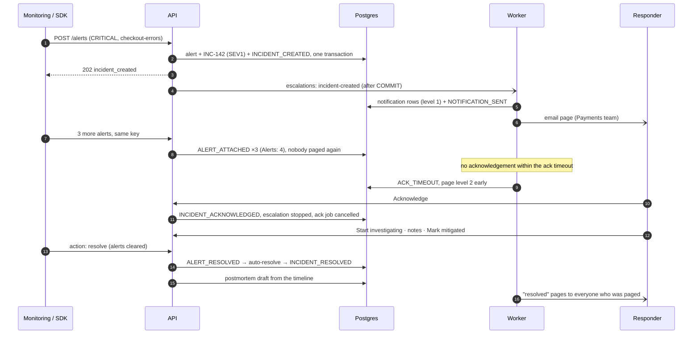

# Incident lifecycle

One incident, end to end: *"Our checkout service is down."* Every step below is something the
platform records, enforces or automates; the timestamps and events it leaves behind are what the
metrics, the postmortem and the [AI investigator](architecture.md#ai-incident-investigator) are
built from.



## 1. Alert → incident

| Alert severity | Incident severity (default rule) | Pages? |
| --- | --- | --- |
| `CRITICAL` | SEV1 | yes |
| `HIGH` | SEV2 | yes |
| `WARNING` | — recorded only (SEV3 if a rule opens one) | no |
| `INFO` | — recorded only (SEV4 if a rule opens one) | no |

1. **Authenticate** the sender by API key (the key decides the service) and rate-limit it.
2. **Idempotency**: a repeat with the same `Idempotency-Key` returns the original answer.
3. **Maintenance**: services in maintenance record alerts without paging.
4. **Correlate**: an open incident with the same `(service, deduplicationKey)` absorbs the alert
   (`ALERT_ATTACHED`); a more severe repeat raises the incident's severity, never lowers it.
5. **Rules** (per service, first match wins): open an incident (optionally overriding severity),
   record only, or suppress.
6. **Open the incident** (`INCIDENT_CREATED`), set the service's status (SEV1 → outage, SEV2 →
   degraded) and schedule paging.

## 2. States

```
TRIGGERED ──► ACKNOWLEDGED ──► INVESTIGATING ──► MITIGATED ──► RESOLVED
    │              │                 │                            ▲
    └──────────────┴─────────────────┴────────────────────────────┘   shortcuts to RESOLVED
```

| State | Meaning | Stamped | Effects |
| --- | --- | --- | --- |
| `triggered` | Something is wrong, nobody owns it yet | `triggered_at` | escalation running; ack timeout armed for SEV1/SEV2 |
| `acknowledged` | A person owns it | `acknowledged_at` (MTTA) | escalation stopped, ack-timeout job cancelled, actor becomes commander if there is none |
| `investigating` | Diagnosis under way | — | — |
| `mitigated` | Customer impact stopped (rollback, failover, flag), cause not yet fixed | `mitigated_at` | SEV1 service goes outage → degraded |
| `resolved` | Done. Final — a recurrence is a new incident | `resolved_at` (MTTR) | "resolved" pages, webhook, postmortem draft, service status recomputed |

Rules, enforced by the API **and** a Postgres trigger: forward only, `resolved` is final, skipping
ahead stamps the skipped timestamps (`mitigated_at = resolved_at`) so metrics stay defined. Every
change takes a row lock, so two people pressing *Acknowledge* together produce one acknowledgement
and one `409`.

## 3. People

- **Incident Commander** (exactly one; database-enforced), **Responders**, read-only **Observers**.
- Whoever acknowledges first becomes commander; the commander (or an admin) hands over command.
- Acting on an incident adds you as a responder.

## 4. Paging and escalation

```
0 min      page step 1 (e.g. Payments team)           ← incident-created job
ack timeout (SEV1/SEV2 only): page the next step now   ← delayed job "ack-timeout-<id>"
N min      page step 2 if still unacknowledged         ← delayed escalation job / sweeper
M min      page step 3 …
acknowledge → everything above stops
```

Delays count from the trigger time. *Escalate* pages the next step on demand, even after
acknowledgement. Postgres holds the escalation state (`escalation_level`, `next_escalation_at`,
`ack_deadline_at`), so a lost queue job delays a page by one sweep (10 s) rather than dropping it.

## 5. The record

Every step writes a typed, append-only, hash-chained **timeline event** and an **audit log** entry
in the same transaction:

`INCIDENT_CREATED · ALERT_ATTACHED · NOTIFICATION_SENT · ACK_TIMEOUT · INCIDENT_ESCALATED ·
INCIDENT_ACKNOWLEDGED · STATUS_CHANGED · SEVERITY_CHANGED · RESPONDER_ADDED · COMMANDER_ASSIGNED ·
NOTE_ADDED · ALERT_RESOLVED · INCIDENT_RESOLVED · POSTMORTEM_GENERATED`

## 6. After resolution

- **Postmortem**: drafted automatically from the timeline (key events, alert storms collapsed,
  each entry linked to its event id and hash), with impact window, what went well / poorly
  pre-filled from facts (missed ack timeouts, time to mitigate) and action items. Optional AI draft
  as a reviewed suggestion; publishing freezes the text.
- **Metrics**: MTTA = `acknowledged_at − triggered_at`, MTTR = `resolved_at − triggered_at`, per
  service and severity, on the dashboard.
